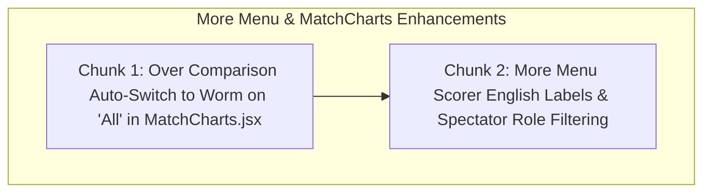

# Implementation Plan: Over Comparison Auto-Worm & More Menu Role Polish

## Overview
1. **Over comparison auto-switch**: In `MatchCharts.jsx`, when the user selects "All" in the view range, automatically switch them to the Worm chart (`setActiveChart('worm')`).
2. **More menu role separation & plain-English labels**: In `MoreMenuModal.jsx`, hide scorer-only editing/audit items in spectator/viewer mode (`Live.jsx`). For scorers (`Scoring.jsx`), provide clear, friendly English descriptions for each action (e.g., explaining "Edit Ball" and "Action Audit Logs") and replace the trophy icon with an intuitive history/log icon.

---

## Technical Architecture

---

## Chunks

- [x] **Chunk 1: Over Comparison Auto-Switch to Worm on 'All'**
  - In `src/components/MatchCharts.jsx`, update the view range handler so clicking "All" automatically activates the Worm chart (`setActiveChart('worm')`).
  - When switching back to "1-10" or "11-20", ensure the bar chart mode is active.
  - Verification: Run Vitest test suite to ensure charts and stats compute accurately (150/150 passed).

- [x] **Chunk 2: More Menu Scorer English Labels & Spectator Role Filtering**
  - In `src/components/MoreMenuModal.jsx`, add an `isViewer` prop:
    - Hide scorer-only controls (`edit_ball`, `action_logs`, `time_declare`, `declare_innings`) when `isViewer={true}` in `src/pages/Live.jsx`.
    - Enhance all cards for scorers in `src/pages/Scoring.jsx` with clear, plain-English descriptive subtitles (e.g., "Fix runs, extras, or wickets on previous balls", "Review complete history of undos and ball events").
    - Replace `Trophy` icon on Action Logs with intuitive `History` icon.
  - Update tests to verify role filtering and friendly labels.
  - Verification: Run Vitest (150/150 tests passing), oxlint, Vite build, and live deploy.
