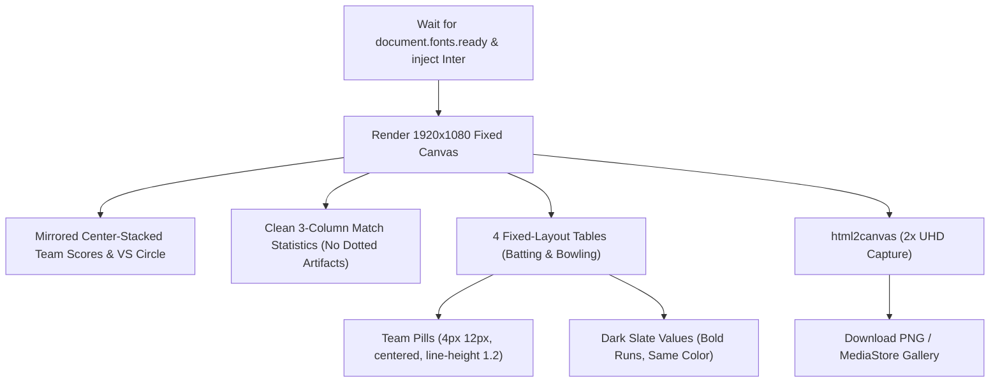

# Implementation Plan: Pixel-Perfect Match Summary Screen & Export Layout

## Overview
Address all 8 items specified by the user for the Match Summary screen and its 4K / 2x exported scorecard graphic:
1. Word Spacing & Font Rendering Fix (prevent collapsed spaces like "BetavsGama", "Nov4,2026", "BetaP1").
2. Table Columns: fixed layout, explicit column widths, numeric columns centered with tabular-nums, player left-aligned, team centered with minimum 12px cell padding.
3. Team Pills: 4px 12px padding, line-height 1.2, white-space nowrap, perfectly centered under Team header.
4. Value Styling: uniform dark slate color across all row values, bold only Runs in the same color, no faint gray.
5. Match Statistics: clean 3 fixed-width centered columns, equal row heights, no stray dashes or dotted artifacts.
6. Sizes & Row Heights: minimum font sizes (headers 12px, body 13px, overs 14px, labels 12px), consistent 40px row heights including empty rows.
7. Header / Score Card: team name, score and overs centered over each other on both sides (mirrored), VS circle centered, date pill uncramped.
8. Complete Verification & Output full updated copy-paste ready code.

---

## Technical Architecture

---

## Chunks

- [x] **Chunk 1: Pixel-Perfect Canvas Architecture in MatchSummaryImageGenerator.jsx**
  - Implement font pre-loading (`document.fonts.ready`), Inter font stack, and non-breaking space preservation.
  - Re-architect Batting and Bowling table cards with fixed table layout, identical explicit column widths, 12px padding, centered numeric tabular-nums, left-aligned player, and centered team pills.
  - Apply uniform dark slate values, bold only Runs in same color.
  - Mirror team headers (team name, score, overs centered over each other), center VS circle, un-cramp date pill.
  - Standardize 3-column Match Statistics card with fixed widths and remove all dotted/dashed artifacts.
  - Enforce minimum font sizes and 40px consistent row heights across all rows (filled & empty).
  - Verification: Vitest unit tests (110/110 passed).

- [x] **Chunk 2: Screen Alignment in MatchSummary.jsx & Regression Verification**
  - Align on-screen `MatchSummary.jsx` elements to match the polished layout and centering.
  - Run full test suite (110 tests) and verify production Vite build.

- [x] **Chunk 3: Build, Deploy to Firebase Hosting & Provide Full Copy-Paste Code**
  - Run `npm run build` and deploy to Firebase Hosting (`smartcricket-c79b5.web.app`).
  - Compile Android APK with Gradle and sync.
  - Update git repository and output complete copy-paste code.

- [x] **Chunk 4: Bring Over Comparison Chart Under Head to Head Comparison on Desktop**
  - In `src/components/PlayersHeadToHead.jsx`, nest the Over Comparison chart (`MatchCharts`) inside the left desktop column directly below the Head-to-Head Comparison card.
  - Maintain clean responsive layout on mobile.
  - Run verification tests, build Vite client, and deploy updates.
