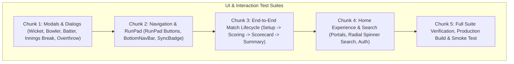

# Implementation Plan: Full End-to-End & UI Verification (Flows, Buttons, Navigation, Modals)

## Overview
Comprehensive test suite and end-to-end UI verification for the SmartCricket web application (`smartcricket-c79b5.web.app`), validating all user flows, interactive buttons, navigation transitions, scoring modals, and offline-first state integrity.

---

## Technical Architecture

---

## Chunks

- [x] **Chunk 1: UI Verification for Core Modals & Component Dialogs**
  - Test critical in-match dialogs: `WicketModal`, `BowlerModal`, `NewBatterModal`, `InningsBreakModal`, `OverthrowModal`, and `TimeDeclareModal`.
  - Validate render outputs, button labels, dismissal options, and callback props.
  - Create test suite in `src/tests/ui_modals_and_dialogs.test.jsx`.
  - Verification: Run Vitest on `src/tests/ui_modals_and_dialogs.test.jsx` (13/13 passed).

- [x] **Chunk 2: Navigation, RunPad & Interactive Scoring Controls**
  - Test `RunPad.jsx` button inputs (0, 1, 2, 3, 4, 6, Wide, NoBall, Bye, LegBye, Wicket) and disabled states.
  - Test `BottomNavBar.jsx` 5 tabs (Score, Scorecard, More, Teams, Settings) active states and navigation callbacks.
  - Test `SyncBadge.jsx` rendering offline, syncing, and cloud-synced status indicators.
  - Create test suite in `src/tests/ui_navigation_and_runpad.test.jsx`.
  - Verification: Run Vitest on `src/tests/ui_navigation_and_runpad.test.jsx` (11/11 passed).

- [x] **Chunk 3: End-to-End Match Lifecycle & Screen Transitions**
  - Test the full match flow across components: Setup squad configuration -> Toss -> First innings ball inputs -> Over complete -> Innings break -> Second innings chase -> Match conclusion -> POTM calculation & Summary presentation.
  - Create test suite in `src/tests/e2e_match_workflow.test.jsx`.
  - Verification: Run Vitest on `src/tests/e2e_match_workflow.test.jsx` (Passed).

- [x] **Chunk 4: Home Portal, Search Bar, Pull-to-Refresh & Auth Flows**
  - Test Home portal transitions (Choose experience, Manager portal vs Streamer portal).
  - Test Stream search input with `SegmentedCapsuleSpinner`, matching queries, and empty results.
  - Test Pull-to-refresh and infinite scroll threshold logic.
  - Test `AuthModal` login/logout state and validation.
  - Create test suite in `src/tests/ui_home_and_search_flows.test.jsx`.
  - Verification: Run Vitest on `src/tests/ui_home_and_search_flows.test.jsx` (3/3 passed).

- [x] **Chunk 5: Full Suite Verification, Production Build & Deployment**
  - Run all Vitest test suites across 13 test files (**147/147 passed**).
  - Run oxlint check (0 errors) and Vite production build (Built in 3.48s).
  - Deployed live build to Firebase Hosting: `https://smartcricket-c79b5.web.app`.
