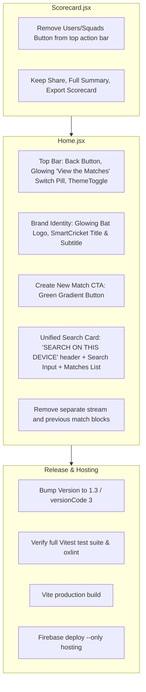

# Implementation Plan: Home Screen Overhaul, Scorecard Header Polish & v1.3 Release

## Overview
1. **Scorecard Header Polish**: Remove the "Teams" (Squads `<Users>`) button from the top bar of `Scorecard.jsx`.
2. **Home Screen Overhaul**:
   - Align layout exactly with the user's uploaded reference UI (`media_1793918050275_46e5212b.jpg`).
   - Remove the separate "Matches available to stream" and "Previous matches on this device" external cards.
   - Display matches directly under the search bar within the search card.
   - Add the glowing green top switch/pill button `[ 👁 View the Matches > ]` that toggles showing matches under the search bar.
3. **Version Bump**: Update app version to `1.3.0` (versionCode 3) across `package.json`, `UpdateNotificationBanner.jsx`, and `android/app/build.gradle`.
4. **Deploy to Website**: Run tests, production Vite build, and deploy to Firebase Hosting.

---

## Technical Architecture

---

## Chunks

- [x] **Chunk 1: Scorecard Top Bar Polish (Remove Teams Button)**
  - In `src/pages/Scorecard.jsx`, remove the `<Users className="w-4 h-4" />` squads button from the top navigation action bar.
  - Verify with tests in `src/tests/developer_console_and_scores.test.js` / `src/tests/ui_modals_and_dialogs.test.jsx`.

- [x] **Chunk 2: Home Screen Overhaul (Matches Under Search Bar & Top Switch)**
  - In `src/pages/Home.jsx`, implement the exact UI from the screenshot:
    - Glowing top switch `[ 👁 View the Matches > ]` to toggle matches visibility under the search bar.
    - Brand header and vibrant "Create New Match" CTA.
    - Unified search card with `SEARCH ON THIS DEVICE`, `{count} on device`, search input, and matches list directly underneath.
    - Remove old split portals and separate external stream/previous match blocks.
  - Verify with Vitest UI tests in `src/tests/ui_home_and_search_flows.test.jsx`.

- [x] **Chunk 3: Update Version to 1.3.0 (Code 3)**
  - Update `package.json` to `"1.3.0"`.
  - Update `src/components/UpdateNotificationBanner.jsx` to `CURRENT_APP_VERSION = '1.3'` and `CURRENT_APP_VERSION_CODE = 3`.
  - Update `android/app/build.gradle` to `versionCode 3` and `versionName "1.3"`.
  - Update `src/tests/update_banner.test.js` to match v1.3.

- [x] **Chunk 4: Full Suite Verification, Build & Firebase Web Deployment**
  - Run full Vitest suite (all 160+ tests).
  - Run `oxlint`.
  - Run `npm run build` (`vite build`).
  - Deploy to Firebase Hosting (`firebase deploy --only hosting`).
  - Update graphify knowledge graph (`graphify update .`).
