# Implementation Plan: Home Header Polish, Match Summary Alignment & Version 1.2 Release

## Overview
1. Clean up `Home.jsx` top header by removing the `Offline Manager` badge and ensuring the corner theme toggle is fully visible without clipping.
2. Refine the Match Summary screen and scorecard image generator so all text inside oval/pill badges (date pill, VS badge, winner banner, team pills, performance tags) is centered using strict flexbox alignment without hardcoded transform offsets, and ensure the Export Scorecard button is properly aligned and functional.
3. Prepare version 1.2, rebuild the APK, publish GitHub Release `v1.2`, and verify that the automated update notification system triggers.

---

## Technical Architecture

```mermaid
flowchart TD
    subgraph UI_Header_Fixes
        H1["Home.jsx Top Bar"] --> H2["Remove Offline Manager Badge"]
        H2 --> H3["Ensure ThemeToggle 100% visible on all viewports"]
    end

    subgraph Match_Summary_Pills_Fix
        MS1["MatchSummaryImageGenerator.jsx"] --> MS2["Replace translateY offsets with flexbox centering"]
        MS2 --> MS3["Standardize Team pills, VS badge, Winner banner, Stat pills"]
        MS3 --> MS4["Export Scorecard button styling & full data verification"]
    end

    subgraph Version_1_2_Release
        V1["Bump to version 1.2 (code 2)"] --> V2["Compile Android APK"]
        V2 --> V3["Publish GitHub Release v1.2 with SmartCricket.apk"]
        V3 --> V4["Update notification triggers for v1.0 users"]
    end
```

---

## Chunks

- [x] **Chunk 1: Top Navigation Bar Cleanup & Theme Toggle Visibility in Home.jsx**
  - Remove `{managerUser && (...)}` Offline Manager badge from the header in `src/pages/Home.jsx`.
  - Ensure header layout has proper flex spacing so the theme toggle icon is never clipped on mobile screens.
  - Verification: Run lint / vitest tests.

- [x] **Chunk 2: Match Summary Oval/Pill Text Centering & Export Scorecard Button**
  - Standardize text alignment across all pill/oval elements in `src/components/MatchSummaryImageGenerator.jsx`:
    - TeamPillBadge in tables: remove hardcoded `translateY`, use pure flexbox centering.
    - Date pill: flexbox centering with `display: flex; align-items: center; justify-content: center;`.
    - VS circular badge: perfect center alignment.
    - Winner result banner: flexbox centering with balanced padding and icon spacing.
    - Match Statistics team pills: flexbox centering with `min-height`, `border-radius: 999px`, and `line-height: 1`.
    - Top Performer points & performance pills: flexbox alignment.
  - In `src/pages/MatchSummary.jsx` and `src/pages/Scorecard.jsx`:
    - Format Export Scorecard button as a balanced pill with centered icon and label.
    - Verify export scorecard generator includes match details, date, teams, scores, result, and full batting/bowling statistics for both innings.
  - Verification: Run 110/110 Vitest tests and check build.

- [ ] **Chunk 3: Version 1.2 Build & GitHub Release Publication**
  - Update version identifiers to `1.2` (versionCode `2`).
  - Rebuild web assets and compile debug APK via `gradlew assembleDebug`.
  - Create and publish GitHub Release `v1.2` with `SmartCricket.apk` using GitHub API.
  - Verification: Verify GitHub Releases API returns `v1.2` with asset `SmartCricket.apk`.
