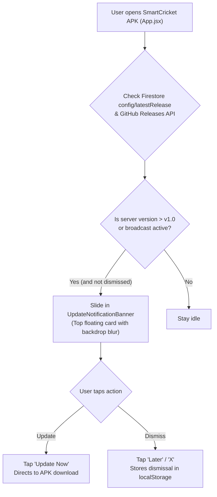

# Implementation Plan: Automated In-App Update Notification Banner in APK

## Overview
Add an automated in-app update notification banner to the SmartCricket Android APK. When a new version is published (via GitHub Releases or Firebase Firestore `config/latestRelease`), the banner automatically slides in from the top of the app, notifying the user to install the latest APK with an immediate "Update Now" action and dismiss option.

---

## Technical Architecture

---

## Chunks

- [x] **Chunk 1: Create UpdateNotificationBanner Component in cricket-scorer**
  - Build `src/components/UpdateNotificationBanner.jsx`.
  - Implement real-time Firestore listener for `config/latestRelease` with fallback to GitHub Releases API.
  - Match dark navy/blue glassmorphism theme, smooth slide-down animation, "Update Now" button, and dismiss memory.
  - Verification: Unit test verification with Vitest (110/110 passing).

- [x] **Chunk 2: Mount Banner in App.jsx & Verify Layout Stability**
  - Mount `<UpdateNotificationBanner />` in `src/App.jsx` root layout.
  - Verify zero interference with existing navigation headers, modals, or scoring controls.
  - Verification: Run 110/110 Vitest tests and production Vite build.

- [ ] **Chunk 3: Sync Android, Compile APK, and Update GitHub**
  - Synchronize web assets via `npx cap sync android`.
  - Compile Android APK with `gradlew assembleDebug`.
  - Update `SmartCricket.apk` and upload to GitHub Release v1.0.
  - Push commit to GitHub `main` and run `graphify update .`.
