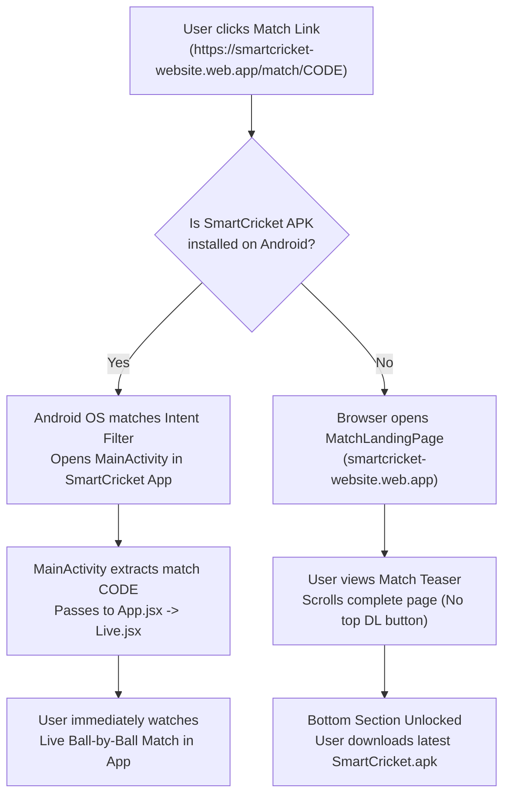

# Implementation Plan: Android Deep Linking, Over Comparison Refinement, Home Exit Icon Removal & 4K Scorecard Export

## Overview
1. **Android Deep Linking & Web Fallback**: Seamless match deep link resolution opening the installed app directly or falling back to the website APK download page with scroll-to-bottom enforcement.
2. **Over Comparison UI Refinement & Real Ball-by-Ball Data**:
   - Refine the highlighted Over 2 card in `MatchCharts.jsx`: compact card height, clean horizontal layout aligning `OVER N` badge, team name, run count, wicket indicator, and total score.
   - Small, circular, evenly spaced ball indicators.
   - Fix incorrect `0 0 0 0 0 0 0 0 0` display by tracing and fixing `stats.js` `overSummaries.balls` to bind to real delivery data (runs, wickets, extras). Show "Ball data unavailable" when empty.
3. **Remove Exit Icon from Main Screen**:
   - Remove the top right exit icon from `Home.jsx`.
4. **4K Scorecard PNG Export & Text Centering**:
   - Export scorecard PNG in 4K (3840x2160 resolution).
   - Adjust vertical baseline in oval blocks and pills so words are not hidden under the bottom boundary and text is properly centered.

---

## Technical Architecture & Flow

---

## Chunks

- [x] **Chunk 1: Configure Android Intent Filters in AndroidManifest.xml & Capacitor**
  - Add `https://smartcricket-website.web.app/match/*` and `/m/*` browsable HTTP/HTTPS intent filter with `android:autoVerify="true"`.
  - Add `smartcricket://match/*` custom scheme intent filter.
  - Verification: Validate XML syntax and ensure `AndroidManifest.xml` complies with Android intent resolution rules.

- [x] **Chunk 2: Native Deep Link Extraction & Webview Event Bridge in MainActivity.java**
  - Extract `Uri uri = getIntent().getData()` in `onCreate()` and `onNewIntent(Intent intent)`.
  - Parse match code from path segments or query parameters.
  - Forward match code into React runtime via `evaluateJavascript("window.handleDeepLink && window.handleDeepLink('" + code + "')")`.
  - Handle both cold start (app launched by link) and warm start (app already in background).
  - Verification: Build Java class and verify compilation with `gradlew compileDebugJavaWithJavac`.

- [x] **Chunk 3: React Deep Link Handling in cricket-scorer (App.jsx & constants.js)**
  - Update `getShareUrl()` in `src/engine/constants.js` to share `https://smartcricket-website.web.app/match/{code}` instead of legacy internal URLs.
  - In `src/App.jsx`, add `window.handleDeepLink` handler and custom event listener to switch page to `live` and load the match code dynamically.
  - Verification: Run Vitest test suite (107/107 tests passing) and Vite build.

- [x] **Chunk 4: Polish MatchLandingPage in smartcricket-website**
  - Replace non-functional hidden iframe with industry-standard Android Chrome Intent URL:
    `intent://match/{CODE}#Intent;scheme=smartcricket;package=com.smartcricket.app;S.browser_fallback_url=https%3A%2F%2Fsmartcricket-website.web.app%2Fmatch%2F{CODE};end;`
  - Add an explicit "Open in SmartCricket App" secondary button at the top for users returning to the page.
  - Retain the strict UX requirement: no top download button; require scrolling to the bottom to unlock and trigger APK download.
  - Verification: Run build test in `smartcricket-website` and deploy to Firebase hosting.

- [x] **Chunk 5: Remove Exit Icon from Main Screen Header in Home.jsx**
  - Remove top right `LogOut` / Exit icon button from `src/pages/Home.jsx`.
  - Preserve clean layout and right-side spacing.
  - Verification: Syntax and Vite build verification.

- [x] **Chunk 6: Fix Ball-by-Ball Delivery Data & Over Summaries in stats.js**
  - Update `computeInningsStats` in `src/engine/stats.js` so `currentOver.balls` stores rich ball objects (`runs`, `ballTotalRuns`, `isWicket`, `extraType`, `isLegal`, `shortLabel`, `ballIndex`) instead of naive strings.
  - Fix mapping in `MatchCharts.jsx` so each ball indicator displays actual runs (`0`, `1`, `2`, `3`, `4`, `6`), wicket indicator (`W` in red), extras (`wd`, `nb`).
  - Add fallback state "Ball data unavailable" when over has no deliveries.
  - Verification: Vitest unit tests in `src/tests/engine.test.js` and `qa_dev_and_match_end.test.js`.

- [x] **Chunk 7: Refine Over Comparison Highlighted Card UI (Over 2 Layout)**
  - In `src/components/MatchCharts.jsx`, refine the highlighted over summary card:
    - Compact height with reduced padding (`p-2.5`).
    - Clean horizontal layout aligning `OVER {N}` badge, team name, run count (`+13` with arrow), wicket indicator (`1W`), and total score (`(Total 30/1)`).
    - Small circular evenly spaced ball indicators with subtle borders, rounded corners, and restrained blue highlights.
    - Preserve the original dark navy and blue theme. Do not modify the graph, navigation bar, other cards, or overall theme.
  - Verification: Component unit test and visual check.

- [x] **Chunk 8: 4K Scorecard PNG Export & Vertical Baseline Text Centering**
  - In `MatchSummaryImageGenerator.jsx`, enable 4K export (scale: 2 for 3840x2160 resolution).
  - In `MatchSummaryImageGenerator.jsx` (and `Scorecard.jsx`), adjust text vertical baseline in oval pill badges and result pills (using `transform: translateY(-2px)`, flex centering, `lineHeight: 1`) so words are not hidden under the bottom boundary and text is properly centered.
  - Verification: Verify image generation and test canvas rendering.

- [x] **Chunk 9: Complete App Build, Full Suite Verification & APK Assembly**
  - Run `npx vitest run` (all tests passing).
  - Run `npm run build` and `npx cap sync android`.
  - Compile Android APK with `gradlew assembleDebug`.
  - Update `SmartCricket.apk` and upload to GitHub Release v1.0.
  - Run `graphify update .`.
