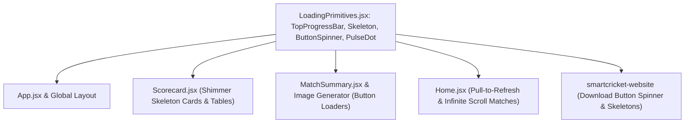

# Implementation Plan: Comprehensive Zero-Lag Loader System

## Overview
Implement an integrated set of zero-lag loaders across the SmartCricket ecosystem to eliminate perceptual waiting time and provide smooth, responsive user feedback:
1. **Progress bar**: Slim top-of-screen animated bar on route and view transitions.
2. **Spinner**: High-performance SVG spinners on async network, search, and export actions.
3. **Skeleton & Pulsing**: Shimmering placeholder skeletons for match cards, scores, and player tables.
4. **Button loader**: Buttons transition into a loading state with inline spinner and disabled click protection.
5. **Pull to refresh**: Touch-friendly pull-down to refresh match list with spring back and spinner indicator.
6. **Infinite scroll**: Smooth incremental pagination of previous matches with bottom loader trigger.

---

## Technical Architecture

---

## Chunks

- [x] **Chunk 1: Core Loader Primitives & Shimmer CSS**
  - Create `src/components/ui/LoadingPrimitives.jsx` with `TopProgressBar`, `ButtonSpinner`, `SkeletonBox`, `SkeletonRow`, and `PulseDot`.
  - Add keyframe animations for shimmer and progress in `src/index.css`.
  - Create unit tests for loading primitives in `src/tests/loaders.test.jsx`.
  - Verification: Run Vitest (117/117 passed).

- [x] **Chunk 2: Skeletons & Button Loaders in Scorecard, MatchSummary & App**
  - Upgrade `Scorecard.jsx` loading state from plain text to realistic scorecard skeleton.
  - Add button loading states to `MatchSummary.jsx` (Export Scorecard) and `MatchSummaryImageGenerator.jsx` (Download & Share).
  - Add `TopProgressBar` to `App.jsx` during tab and route transitions.
  - Verification: Run Vitest (117/117 passed) & Vite build.

- [x] **Chunk 3: Pull-to-Refresh & Infinite Scroll on Home Match List**
  - Add touch pull-to-refresh listener on `Home.jsx` with pull indicator spinner.
  - Add infinite scroll pagination to previous matches in `Home.jsx` with bottom loading trigger.
  - Verification: Run Vitest & Vite build (all 117 tests pass, build succeeded).

- [x] **Chunk 4: Website Loaders, Build, and Deploy**
  - Add button loaders and match skeleton to `smartcricket-website`.
  - Build and deploy both web targets to Firebase Hosting (`smartcricket-c79b5` and `smartcricket-website`).
  - Sync Capacitor, assemble Android APK, and update GitHub Release v1.2 asset.

- [x] **Chunk 5: Segmented Capsule Spinner, Match Search UI & Bottom Nav Skeleton Transitions**
  - Implement 10-petal `SegmentedCapsuleSpinner` in `src/components/ui/LoadingPrimitives.jsx` matching user uploaded images.
  - Upgrade match search interface in `src/pages/Home.jsx` with light blue pill input and centered capsule spinner.
  - Implement tab shifting skeleton animation in `src/pages/Live.jsx` and `src/pages/Scoring.jsx` on bottom navigation panel changes.
  - Verification: Run Vitest tests (119/119 passed), compile production build, and deploy to Firebase Hosting.
