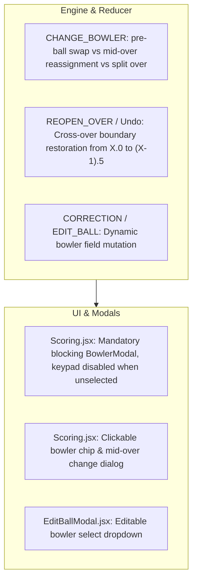

# Implementation Plan: Bowler Assignment & Mid-Over Correction

## Overview
Address critical scoring workflow vulnerabilities where incorrect bowlers can be locked into match scorecards:
1. **Prevent Silent Bowler Auto-Default**: Mandatory blocking modal at over completion, disabling scoring keypad until confirmed with no fallback to squad[0].
2. **Mid-Over & Pre-Ball Bowler Changes**: Clickable bowler chip with full-over reassignment (fix mistake) vs split-over (injury/disqualification).
3. **Bowler Dropdown in Edit Ball Score**: Turn static bowler text in `EditBallModal.jsx` into an editable fielding squad dropdown.
4. **Cross-Over Undo**: Allow Undo at `X.0` overs to seamlessly reopen the previous over and revert the over-end transition.
*Note: Local development & verification only. Do not deploy to web.*

---

## Technical Architecture

---

## Chunks

- [x] **Chunk 1: Engine & Store Support for Mid-Over Bowler Change & Cross-Over Undo**
  - Update `src/engine/reducer.js` to handle `CHANGE_BOWLER` with `mode: 'reassign_over' | 'split_over'` and clean pre-ball swaps.
  - Ensure `undoLastEvent` and `REOPEN_PREVIOUS_OVER` cleanly rewind across over transitions (`X.0` to `X-1.5`) restoring previous bowler and striker state.
  - Ensure `CORRECTION` event supports changing `bowler` on historical ball deliveries.
  - Verification: Vitest tests in `src/tests/bowler_assignment_and_undo.test.js`.

- [x] **Chunk 2: Prevent Silent Bowler Auto-Default & Mandatory Modal**
  - In `src/pages/Scoring.jsx`, eliminate any silent default bowler assignment (e.g. `bowlers[0]`).
  - Disable RunPad keypad and keyboard scoring shortcuts whenever `needsBowlerChange` is true or bowler is unset.
  - Make `BowlerModal` persistent/non-dismissible until a valid bowler is explicitly selected.
  - Verification: Vitest component tests.

- [x] **Chunk 3: Mid-Over & Pre-Ball Bowler Change UI in Scoring Screen**
  - In `src/pages/Scoring.jsx`, make the active bowler badge/card clickable with a "Change Bowler" option.
  - If 0 balls in over: direct bowler swap with zero stat impact.
  - If 1–5 balls in over: present selection modal:
    - *Full Over Reassignment*: Reassign all balls in active over to new bowler (fix scorer mistake).
    - *Split Over*: Retain injured/disqualified bowler's balls and bring in replacement for remaining deliveries.
  - Verification: Vitest UI simulation tests.

- [x] **Chunk 4: Bowler Dropdown in EditBallModal**
  - In `src/components/EditBallModal.jsx`, replace read-only bowler text with an interactive `<select>` dropdown populated from `bowlingSquad`.
  - Pass updated `bowler` in `onSaveBall` callback so historical ball events reflect the true bowler.
  - Verification: Vitest tests for `EditBallModal`.

- [x] **Chunk 5: Full Suite Verification & Build (NO Web Deploy)**
  - Run all Vitest test suites (150+ tests).
  - Run oxlint and compile production Vite build.
  - Commit changes locally (NO deploy to Firebase Hosting).
